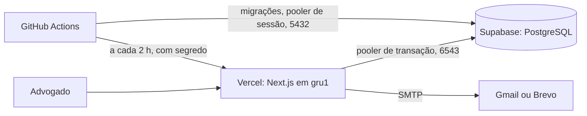

# Tempestivo

**Nunca perder prazo e receber honorário.** O Tempestivo é um aplicativo web para o advogado autônomo: calcula o prazo e explica a contagem, cobra do próprio advogado a conferência, avisa por e-mail antes do vencimento e acompanha os honorários até o pagamento.

Projeto do Startup Challenge UMC 2026 (Mestres da Web). Custo zero de infraestrutura, por desenho.

> **Cálculo auxiliar, confira.** As regras de contagem ainda não foram validadas por um advogado, e a tela diz isso em todo cálculo. O Tempestivo não substitui a conferência do prazo nos autos.

## Sumário

- [O que ele faz](#o-que-ele-faz)
- [O que o diferencia](#o-que-o-diferencia)
- [Tecnologias](#tecnologias)
- [Arquitetura](#arquitetura)
- [Instalação](#instalação)
- [Configuração](#configuração)
- [Execução](#execução)
- [Testes](#testes)
- [CI/CD e segurança](#cicd-e-segurança)
- [Deploy](#deploy)
- [Limites conhecidos e roadmap](#limites-conhecidos-e-roadmap)
- [Documentação técnica](#documentação-técnica)
- [Contribuição](#contribuição)

## O que ele faz

| Área | Funcionalidades |
|---|---|
| **Prazos** | Calculadora para CPC e CLT (TJSP e TRT-2), em dias úteis: feriados nacionais e de SP, suspensão de 20/12 a 20/01, prazo em dobro, quatro tipos de evento. Catálogo de 13 tipos de prazo ajustável por conta. Dias sem expediente cadastrados pelo advogado. Data final manual para o que a calculadora não atende. |
| **Conferência** | Enquanto as regras não forem validadas, a data calculada só é salva com a declaração "conferi nos autos". Botão "li e conferi" com data, hora e canal. Histórico de toda alteração de data. Editar a contagem zera a conferência. |
| **Alertas** | E-mail 5, 2 e 1 dia útil antes e no dia do vencimento, com link para registrar a conferência sem login. Escalada a um advogado substituto na véspera útil sem conferência; ele recebe só a data e só depois de aceitar o convite. |
| **Leitor de intimação** | Cole o texto e receba um rascunho do prazo, com o trecho de onde saiu cada campo. |
| **Processos e clientes** | Cadastro, busca, arquivamento, validação de CPF/CNPJ e do número único do CNJ. |
| **Honorários** | Parcelas mensais, situação de cada parcela, resumo do mês e cobrança pronta para enviar pelo WhatsApp. |
| **Meta interna** | Cada prazo ganha uma data-alvo alguns dias úteis antes do vencimento (2 por padrão, até 10, ajustável na conta). A lista, o detalhe e o painel mostram a meta e avisam quando ela chega. |
| **Agenda no celular** | Um link de calendário assinável (iCalendar) leva vencimentos, metas internas e audiências para o Google Agenda, o Apple Calendário ou o Outlook, com lembretes, e se atualiza sozinho. O link é secreto, pode ser revogado a qualquer momento e não leva nome de cliente nem de parte. |
| **Audiências** | Agenda com rota, sala virtual e arquivo `.ics` para qualquer calendário. |
| **Tarefas** | Quadro de três colunas. |
| **Painel** | O que pede atenção hoje, a semana, as audiências e o dinheiro, em uma tela feita para o celular. |
| **Planilhas** | Excel (`.xlsx`) de clientes, processos, prazos, honorários e parcelas, audiências e tarefas, com o filtro da tela, e uma planilha completa com resumo. Prazos saem com "cálculo auxiliar, confira". |
| **Conta e LGPD** | Termos de uso e Política de privacidade com aceite registrado. Confirmação do e-mail da conta, troca de senha e verificação em duas etapas por aplicativo autenticador, com códigos de recuperação. Exportação de todos os dados em JSON e exclusão definitiva, confirmada com a senha. |

## O que o diferencia

- **Status honesto.** Um prazo não fica "ok" só porque foi cadastrado. Ele mostra há quantos dias o próprio advogado conferiu e pede atenção depois de três dias sem conferência.
- **A data nunca vem sem a conta.** Todo cálculo traz o passo a passo, as regras aplicadas com a referência legal e os avisos. O formulário só deixa salvar depois que o advogado vê a contagem.
- **Na dúvida, a data sai mais cedo e com aviso.** Carnaval, Corpus Christi e pontos facultativos dependem de portaria de cada tribunal. A calculadora não presume a suspensão: conta o dia como útil, avisa e deixa o advogado cadastrar o dia sem expediente.
- **Recusa em vez de chute.** Tribunal fora do escopo, Juizado Especial, prazo em horas ou em dias corridos e contagem controvertida não geram data: a tela pede a data manual.
- **A leitura da intimação só sugere, e fica em casa.** O extrator roda no próprio servidor, por regras: o texto não é enviado a terceiros nem gravado. O prazo só existe depois de conferido e salvo.
- **Rede de segurança humana.** Se o titular não conferir até a véspera útil, um colega indicado por ele recebe um e-mail. O colega precisa aceitar o convite antes, recebe só a data e não ganha acesso ao sistema.
- **Folga antes do prazo, onde o advogado já olha.** A meta interna é contada em dias úteis com o mesmo calendário da calculadora, e a agenda assinável põe vencimento e meta no calendário do celular sem integração paga nem aplicativo: só um link que qualquer agenda entende. O feed leva o mínimo (ato, número do processo e datas), porque o calendário fica fora do sistema.
- **Link de conferência seguro.** O token é de uso único, expira, só o resumo SHA-256 fica no banco, e abrir o link não confirma nada: a confirmação é um clique explícito, para antivírus de e-mail não "conferirem" o prazo sozinhos.

## Tecnologias

| Camada | Escolha |
|---|---|
| Aplicação | Next.js 16 (App Router), React 19, TypeScript estrito |
| Interface | Tailwind CSS 4, shadcn/ui (Radix), ícones lucide, fonte Archivo (next/font), tema claro e escuro |
| Banco | PostgreSQL 17, Prisma 7 |
| Login | Better Auth, senhas em Argon2id, sessão em cookie `HttpOnly`, segundo fator opcional (TOTP) |
| E-mail | SMTP via nodemailer (Gmail ou Brevo; Mailpit em desenvolvimento) |
| Validação | zod |
| Testes | Vitest com cobertura mínima (unidade e integração com Postgres e SMTP reais), Playwright (telas em 320, 360, 768 e 1280 px, com verificação de acessibilidade) |
| Entrega | GitHub Actions, Docker, Vercel |

Todas as dependências têm licença permissiva (MIT, Apache-2.0, BSD).

## Arquitetura

Monólito modular com portas e adaptadores.

```
src/
  app/                 telas e rotas. Chamam serviços; nunca tocam o banco.
    (publico)/         entrar, cadastro, recuperar e redefinir senha
    (app)/             área logada: painel, prazos, processos, clientes, honorários, audiências, tarefas, conta
    conferir/[token]/  link "li e conferi" do e-mail (sem login)
    agenda/[token]/    calendário assinável (.ics), lido pelo app de agenda
    api/               saúde, autenticação e jobs
  modules/<módulo>/    regra de negócio. Só o index.ts é público.
                       conta, clientes, processos, prazos, alertas, intimacao,
                       honorarios, audiencias, tarefas, agenda
    servico.ts           casos de uso, validação com zod, mensagens em português
    repositorio.ts       acesso ao banco, sempre com contaId
    dominio/ ou *.ts     regras puras, testáveis sem infraestrutura
  platform/<porta>/    tudo o que é externo, atrás de uma interface (config, database,
                       auth, mailer, ai, scheduler, logger, health, runtime)
  components/          componentes de interface
  lib/                 utilitários puros compartilhados (datas civis, dinheiro, documentos)
prisma/                esquema e migrações versionadas
e2e/                   testes de tela
docs/                  deploy, mapa de módulos e especificações
```

Regras que o código impõe:

- **Todo registro pertence a uma conta.** Todo método de repositório recebe `contaId` como primeiro parâmetro e filtra por ele. Cada módulo tem um teste de que a conta B não enxerga nem altera dados da conta A.
- **Fronteiras por lint.** Um módulo só importa outro pelo `index.ts`; telas não importam o banco; nada exclusivo de um provedor (`@vercel/*`). As regras estão em `eslint.config.mjs` e são provadas em `src/lint/fronteiras.test.ts`.
- **Datas civis sem fuso.** Prazo e vencimento são texto `AAAA-MM-DD`. O fuso `America/Sao_Paulo` só aparece na borda, em `src/lib/datas.ts`.
- **Jobs idempotentes.** Cada alerta tem chave única (`prazo:camada:data`), reservada no banco antes do envio.
- **Servidor fica no servidor.** Banco, sessão e runtime importam `server-only`: se um componente de cliente tentar importá-los, o build quebra.
- **Configuração só por ambiente,** validada na subida. Variável inválida derruba o servidor com a lista dos nomes, nunca dos valores.

O mapa completo de módulos e portas está em [docs/mapa-de-modulos.md](docs/mapa-de-modulos.md), e as decisões de arquitetura, com o motivo de cada uma, em [docs/arquitetura.md](docs/arquitetura.md).

## Instalação

Pré-requisitos:

- Node.js **24.22.1** (há um `.nvmrc`)
- pnpm **12.16.1**. Se a sua máquina tiver outra versão, use o Corepack, que lê a versão do `package.json`: troque `pnpm` por `corepack pnpm` nos comandos abaixo.
- Docker, para o banco e a caixa de e-mail locais

```bash
pnpm install
```

```bash
cp .env.example .env
```

```bash
docker compose up -d
```

```bash
pnpm db:aplicar
```

O `docker compose` sobe o PostgreSQL na porta **54329** e o Mailpit (SMTP na **54325**, caixa de entrada em http://localhost:54380). As portas fogem do padrão de propósito, para não disputar com serviços já instalados.

## Configuração

Abra o `.env` e preencha `JOBS_SECRET` e `AUTH_SECRET` com dois valores diferentes de pelo menos 32 caracteres:

```bash
node -e "console.log(require('crypto').randomBytes(32).toString('hex'))"
```

As demais variáveis já vêm prontas para o ambiente local. Cada uma tem um comentário em [`.env.example`](.env.example); a tabela de produção está em [docs/deploy.md](docs/deploy.md).

O `.env` é ignorado pelo Git. Use só dados fictícios em desenvolvimento e em demonstrações.

## Execução

```bash
pnpm dev
```

Abra http://localhost:3000 e crie uma conta. Os e-mails (confirmação de e-mail, redefinição de senha, convite ao substituto e alertas) aparecem no Mailpit. Os alertas só são enviados depois que você confirma o e-mail da conta pelo link que chega lá.

Para disparar os alertas à mão, como o agendador faz:

```bash
curl -X POST -H "Authorization: Bearer $JOBS_SECRET" http://localhost:3000/api/jobs/alertas
```

| Comando | O que faz |
|---|---|
| `pnpm dev` | servidor de desenvolvimento |
| `pnpm build` / `pnpm start` | build e servidor de produção |
| `pnpm db:migrar --name <nome>` | cria e aplica uma migração depois de mudar `prisma/schema.prisma` |
| `pnpm db:aplicar` | aplica as migrações pendentes |
| `pnpm lint` | ESLint, com as fronteiras de arquitetura |
| `pnpm typecheck` | tipos do Next e `tsc` |
| `pnpm test` | testes de unidade e de integração |
| `pnpm test:cobertura` | os mesmos testes, com relatório em `coverage/` e metas mínimas |
| `pnpm e2e` | testes de tela, com acessibilidade |
| `pnpm imagens` | gera favicon, ícones do app e imagem de compartilhamento a partir do símbolo |
| `pnpm verificar` | lint, tipos, testes e build, nesta ordem |

## Testes

```bash
pnpm test
```

Os testes de integração usam o PostgreSQL e o Mailpit do `docker compose` (ou os do CI) e criam contas fictícias descartáveis: o envio de e-mail é conferido no servidor SMTP de verdade, e a senha com o hash Argon2id real. A calculadora de prazos tem, além dos casos conferidos à mão, testes de propriedade sobre dois anos de calendário: a data final nunca cai em dia sem expediente e mais dias nunca antecipam o vencimento.

```bash
pnpm e2e
```

```bash
pnpm test:cobertura
```

A cobertura de `src/modules`, `src/lib` e `src/platform` tem metas mínimas que falham o CI: 90% das instruções, 85% dos ramos, 90% das funções e das linhas (em 26/11/2026: 95,6%, 89,9%, 97,5% e 97,3%). Ficam de fora só a montagem do Better Auth e a leitura da sessão, cobertas pelos testes de tela. Um teste lê `globals.css` e confere o contraste WCAG de cada par de cores, no tema claro e no escuro.

Os testes de tela rodam contra o build de produção, em 360, 768 e 1280 px, e conferem que nenhuma tela tem rolagem horizontal. Toda rota, logada ou pública, passa por uma verificação de acessibilidade: idioma da página, um único `h1` e um único `main`, títulos sem salto de nível, campos com rótulo, botões e links com nome, imagens com texto alternativo e nada focável escondido de leitor de tela. Também há um teste de reflow a 320 px. A verificação automática não substitui o teste com teclado e leitor de tela. Na primeira vez, instale o navegador com `pnpm exec playwright install chromium`. Se a máquina bloquear o Chromium baixado, use o Edge ou o Chrome instalados: `PLAYWRIGHT_CHANNEL=msedge pnpm e2e`.

Os casos de contagem para o advogado validador ficam em `src/modules/prazos/__fixtures__/casos-validados.json`, e as regras com a referência legal em [`src/modules/prazos/regras.md`](src/modules/prazos/regras.md).

## CI/CD e segurança

| Workflow | Quando | O que faz |
|---|---|---|
| `ci.yml` | todo PR, inclusive de fork, e todo push na `main` | lint, tipos, migrações em Postgres 17, checagem de migração pendente, testes com cobertura mínima (Postgres e Mailpit reais), build, e2e com acessibilidade nas quatro larguras; constrói a imagem, aplica as migrações, sobe o contêiner e confere `/api/health` e o usuário sem root |
| `seguranca.yml` | todo PR, todo push na `main` e toda segunda-feira | segredos em todo o histórico (TruffleHog), CVE nas dependências (Trivy), análise estática (Semgrep); CVE e SBOM da imagem (Trivy) na `main`, na varredura semanal e sob demanda |
| `jobs.yml` | agendado a cada 2 horas (o GitHub costuma atrasar) | chama os jobs do app com o segredo |
| `migrar.yml` | manual, com confirmação | aplica as migrações em produção |

Achado de severidade alta ou crítica bloqueia o PR. As actions são fixadas por SHA de commit, as imagens por digest e os binários conferidos por `sha256`. O Dependabot abre atualizações agrupadas toda semana.

A política de relato de vulnerabilidades e as práticas do projeto estão em [SECURITY.md](SECURITY.md).

## Deploy

O caminho padrão é **Vercel Hobby + Supabase Free**, ambos gratuitos, sem que o código dependa de nenhum dos dois: o app só conhece uma `DATABASE_URL` de PostgreSQL e um SMTP. O mesmo build roda em qualquer servidor pela imagem Docker (`Dockerfile`, alvos `runner` e `migrator`).



Resumo do roteiro:

1. Crie o projeto no Supabase (região São Paulo) e copie as duas strings do diálogo **Connect**: o pooler de transação (porta 6543, com `?pgbouncer=true`) para o app e o pooler de sessão (porta 5432) para as migrações.
2. No GitHub, crie o ambiente `producao` com o segredo `DATABASE_URL_MIGRACAO` (pooler de sessão) e rode o workflow **Migrar o banco de produção**.
3. Importe o repositório na Vercel e preencha as variáveis da tabela de [docs/deploy.md](docs/deploy.md): `DATABASE_URL` (pooler de transação), `APP_URL`, `AUTH_SECRET`, `JOBS_SECRET`, SMTP e, para verificar o certificado do banco, `DATABASE_CA_CERT`.
4. No GitHub, cadastre os segredos `APP_URL` e `JOBS_SECRET` para o agendador (`jobs.yml`).
5. Confira `GET /api/health`, crie uma conta e receba o e-mail de confirmação.

O passo a passo completo, com isolamento das prévias, ordem de entrega, rollback e solução de problemas, está em [docs/deploy.md](docs/deploy.md).

## Limites conhecidos e roadmap

Limites de hoje, ditos sem rodeio:

- **Regras de prazo sem validação jurídica.** Todas estão como `pendente` até um advogado conferir os casos; até lá, cada data calculada exige a declaração de conferência ao salvar. Os pontos em aberto estão em [`regras.md`](src/modules/prazos/regras.md).
- **Só TJSP e TRT-2.** Nos demais tribunais a data final é digitada.
- **Feriados municipais** não estão na tabela: entram como dia sem expediente cadastrado pelo advogado.
- **Limitador de tentativas em memória.** Vale por instância do servidor e depende de um proxy que sobrescreva o `X-Forwarded-For`.
- **Termos de uso e Política de privacidade** descrevem o que o sistema faz, mas ainda não passaram por revisão jurídica.
- **Uma pessoa por conta.**
- **Hospedagem gratuita.** A produção está na Vercel (plano Hobby, só para uso não comercial) com Supabase. Antes de vender o produto, a hospedagem precisa ser revista.

Próximos passos, fora do MVP:

- Validação das regras por advogado e ampliação para outros tribunais
- Leitor de intimação com modelo de linguagem, atrás da mesma porta e só com dados anonimizados
- Anexos de documentos e comprovantes
- Aplicativo instalável (PWA) com notificações push
- Cobrança por Pix e WhatsApp pela API oficial
- Várias pessoas por conta

## Documentação técnica

O índice completo está em [docs/README.md](docs/README.md):

| Documento | Assunto |
|---|---|
| [Arquitetura](docs/arquitetura.md) | Camadas, fluxo de uma requisição e registro de decisões |
| [Mapa de módulos](docs/mapa-de-modulos.md) | Módulos, portas e dependências |
| [Modelo de dados](docs/modelo-de-dados.md) | Entidades, convenções e migrações |
| [Rotas e interfaces](docs/rotas-e-api.md) | Páginas, rotas HTTP, Server Actions e contratos |
| [Testes](docs/testes.md) | Estratégia, cobertura e como escrever um teste |
| [Deploy](docs/deploy.md) | Vercel + Supabase e imagem Docker |
| [Operação](docs/operacao.md) | Saúde, logs, jobs, incidentes e backup |
| [Especificações](docs/especificacoes/) | Base, prazos e agenda |

## Contribuição

1. Crie uma branch a partir da `main`. A `main` é protegida: toda mudança entra por pull request, com revisão cruzada.
2. Trabalhe em fatias pequenas, com o teste primeiro no domínio. Um commit por fatia, mensagem em português no imperativo.
3. Antes de abrir o PR, rode `pnpm verificar` e `pnpm e2e`.
4. Mudou o esquema do banco? Gere a migração com `pnpm db:migrar --name <nome>` e inclua no mesmo PR.
5. Regra de prazo só entra com teste, referência legal e registro em `regras.ts`.
6. Dependência nova: confira a licença e o custo, e cite no PR.

As regras do projeto, o método de trabalho e a definição de pronto estão em [CLAUDE.md](CLAUDE.md).
