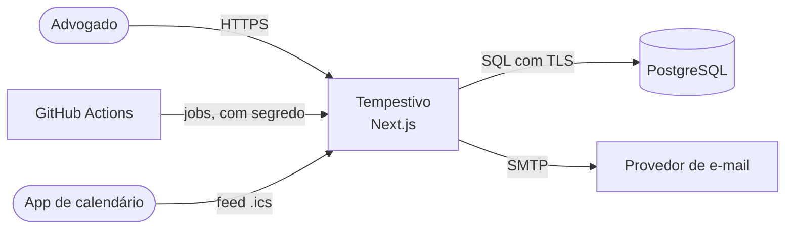

# Tempestivo

Aplicativo web para o advogado autônomo **não perder prazo e receber honorário**: calcula o prazo e explica a contagem, cobra a conferência, avisa por e-mail antes do vencimento e acompanha os honorários até o pagamento.

**No ar:** https://tempestivo-app.vercel.app

> **Cálculo auxiliar, confira.** As regras de contagem ainda não foram validadas por um advogado, e a tela diz isso em todo cálculo. O Tempestivo não substitui a conferência do prazo nos autos.

Projeto do Startup Challenge UMC 2026 (Mestres da Web), com infraestrutura de custo zero.

## O que ele faz

| Área | Funcionalidades |
|---|---|
| **Prazos** | Calculadora para CPC e CLT (TJSP e TRT-2), em dias úteis: feriados nacionais e de SP, suspensão de 20/12 a 20/01, prazo em dobro, quatro tipos de evento. Catálogo de 13 tipos de prazo ajustável por conta. Dias sem expediente cadastrados pelo advogado. Data final manual para o que a calculadora não atende. |
| **Conferência** | Enquanto as regras não forem validadas, a data calculada só é salva com a declaração "conferi nos autos". Botão "li e conferi" com data, hora e canal. Histórico de toda alteração de data. Editar a contagem zera a conferência. |
| **Alertas** | E-mail 5, 2 e 1 dia útil antes e no dia do vencimento, com link para registrar a conferência sem login. Escalada a um advogado substituto na véspera útil sem conferência; ele recebe só a data e só depois de aceitar o convite. |
| **Leitor de intimação** | Cole o texto e receba um rascunho do prazo, com o trecho de onde saiu cada campo. |
| **Processos e clientes** | Cadastro, busca, arquivamento, validação de CPF/CNPJ e do número único do CNJ. |
| **Honorários** | Parcelas mensais, situação de cada parcela, resumo do mês e cobrança pronta para enviar pelo WhatsApp. |
| **Meta interna** | Cada prazo ganha uma data-alvo alguns dias úteis antes do vencimento (2 por padrão, até 10, ajustável na conta). A lista, o detalhe e o painel mostram a meta e avisam quando ela chega. |
| **Agenda no celular** | Um link de calendário assinável (iCalendar) leva vencimentos, metas internas e audiências para o Google Agenda, o Apple Calendário ou o Outlook, com lembretes, e se atualiza sozinho. O link é secreto, pode ser revogado a qualquer momento e não leva nome de cliente nem de parte. |
| **Audiências** | Agenda com rota, sala virtual e arquivo `.ics` para qualquer calendário. |
| **Tarefas** | Quadro de três colunas. |
| **Painel** | O que pede atenção hoje, a semana, as audiências e o dinheiro, em uma tela feita para o celular. |
| **Planilhas** | Excel (`.xlsx`) de clientes, processos, prazos, honorários e parcelas, audiências e tarefas, com o filtro da tela, e uma planilha completa com resumo. Prazos saem com "cálculo auxiliar, confira". |
| **Conta e LGPD** | Termos de uso e Política de privacidade com aceite registrado. Confirmação do e-mail da conta, troca de senha e verificação em duas etapas por aplicativo autenticador, com códigos de recuperação. Exportação de todos os dados em JSON e exclusão definitiva, confirmada com a senha. |

## O que o diferencia

- **Status honesto.** Um prazo não fica "ok" só porque foi cadastrado. Ele mostra há quantos dias o próprio advogado conferiu e pede atenção depois de três dias sem conferência.
- **A data nunca vem sem a conta.** Todo cálculo traz o passo a passo, as regras aplicadas com a referência legal e os avisos. O formulário só deixa salvar depois que o advogado vê a contagem.
- **Na dúvida, a data sai mais cedo e com aviso.** Carnaval, Corpus Christi e pontos facultativos dependem de portaria de cada tribunal. A calculadora não presume a suspensão: conta o dia como útil, avisa e deixa o advogado cadastrar o dia sem expediente.
- **Recusa em vez de chute.** Tribunal fora do escopo, Juizado Especial, prazo em horas ou em dias corridos e contagem controvertida não geram data: a tela pede a data manual.
- **A leitura da intimação só sugere, e fica em casa.** O extrator roda no próprio servidor, por regras: o texto não é enviado a terceiros nem gravado. O prazo só existe depois de conferido e salvo.
- **Rede de segurança humana.** Se o titular não conferir até a véspera útil, um colega indicado por ele recebe um e-mail. O colega precisa aceitar o convite antes, recebe só a data e não ganha acesso ao sistema.
- **Folga antes do prazo, onde o advogado já olha.** A meta interna é contada em dias úteis com o mesmo calendário da calculadora, e a agenda assinável põe vencimento e meta no calendário do celular sem integração paga nem aplicativo: só um link que qualquer agenda entende. O feed leva o mínimo (ato, número do processo e datas), porque o calendário fica fora do sistema.
- **Link de conferência seguro.** O token é de uso único, expira, só o resumo SHA-256 fica no banco, e abrir o link não confirma nada: a confirmação é um clique explícito, para antivírus de e-mail não "conferirem" o prazo sozinhos.

## Tecnologias

| Camada | Escolha |
|---|---|
| Aplicação | Next.js 16 (App Router), React 19, TypeScript estrito |
| Interface | Tailwind CSS 4, shadcn/ui (Radix), ícones lucide, fonte Archivo (next/font), tema claro e escuro |
| Banco | PostgreSQL 17, Prisma 7 |
| Login | Better Auth, senhas em Argon2id, sessão em cookie `HttpOnly`, segundo fator opcional (TOTP) |
| E-mail | SMTP via nodemailer (Gmail ou Brevo; Mailpit em desenvolvimento) |
| Validação | zod |
| Testes | Vitest com cobertura mínima (unidade e integração com Postgres e SMTP reais), Playwright (telas em 320, 360, 768 e 1280 px, com verificação de acessibilidade) |
| Entrega | GitHub Actions, Docker, Vercel |

Todas as dependências têm licença permissiva (MIT, Apache-2.0, BSD).

## Arquitetura

Monólito modular com portas e adaptadores.



| Pasta | Conteúdo |
| --- | --- |
| `src/app/` | telas e rotas; chamam os serviços e nunca o banco |
| `src/modules/<módulo>/` | regra de negócio; só o `index.ts` é público |
| `src/platform/<porta>/` | tudo o que é externo, atrás de uma interface |
| `src/components/` | componentes de interface |
| `src/lib/` | utilitários puros compartilhados |
| `prisma/` | esquema e migrações versionadas |
| `e2e/` | testes de tela |
| `docs/` | documentação técnica |

Detalhes na [visão geral da arquitetura](docs/arquitetura/visao-geral.md) e no [registro de decisões](docs/adr/README.md).

## Como executar

Requer Node.js 24.22.1, pnpm 12.16.1 e Docker.

```bash
pnpm install
```

```bash
cp .env.example .env
```

Preencha `JOBS_SECRET` e `AUTH_SECRET` no `.env`, como explica o [guia de desenvolvimento local](docs/guias/desenvolvimento-local.md). Depois:

```bash
docker compose up -d
```

```bash
pnpm db:aplicar
```

```bash
pnpm dev
```

O app responde em `http://localhost:3000`.

## Qualidade

```bash
pnpm verificar
```

```bash
pnpm e2e
```

`verificar` roda lint, tipos, testes e build; `e2e` roda os testes de tela, em 360, 768 e 1280 px. O CI exige cobertura mínima de 90% das instruções, 85% dos ramos, 90% das funções e 90% das linhas em `src/modules`, `src/lib` e `src/platform`. Ver o [guia de testes](docs/guias/testes.md).

| Workflow | Quando | O que faz |
| --- | --- | --- |
| `ci.yml` | pull requests e `main` | lint, tipos, migrações, testes, build, testes de tela e imagem Docker |
| `seguranca.yml` | pull requests, `main` e toda semana | segredos, dependências e análise estática; imagem e SBOM na `main`, na rotina semanal e sob demanda |
| `jobs.yml` | agendado | chama os jobs do app |
| `migrar.yml` | manual, com aprovação | aplica as migrações em produção |

## Publicação

O ambiente atual é Vercel (plano Hobby) com Supabase usado como PostgreSQL. **Todo merge na `main` publica em produção.** A imagem Docker roda o mesmo app em outra hospedagem. Ver o [guia de publicação](docs/guias/publicacao.md) e a [operação](docs/operacao/README.md).

## Limites conhecidos

- **Regras de prazo sem validação jurídica.** Cada data calculada exige a declaração de conferência ao salvar.
- Só TJSP e TRT-2. Nos demais tribunais a data final é digitada.
- Uma pessoa por conta.
- Termos de uso e Política de privacidade sem revisão jurídica.
- A hospedagem gratuita é só para uso não comercial.

A lista completa, com o que está fora do escopo, está nos [requisitos](docs/requisitos.md#limitações-conhecidas).

## Documentação

O índice está em [docs/README.md](docs/README.md). Para contribuir, leia o [CONTRIBUTING.md](CONTRIBUTING.md); as mudanças estão no [CHANGELOG.md](CHANGELOG.md); falhas de segurança, no [SECURITY.md](SECURITY.md).
