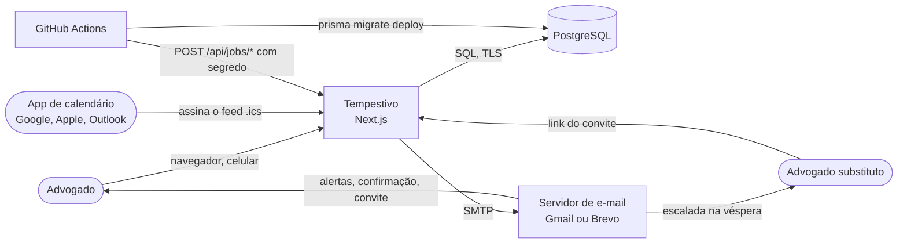
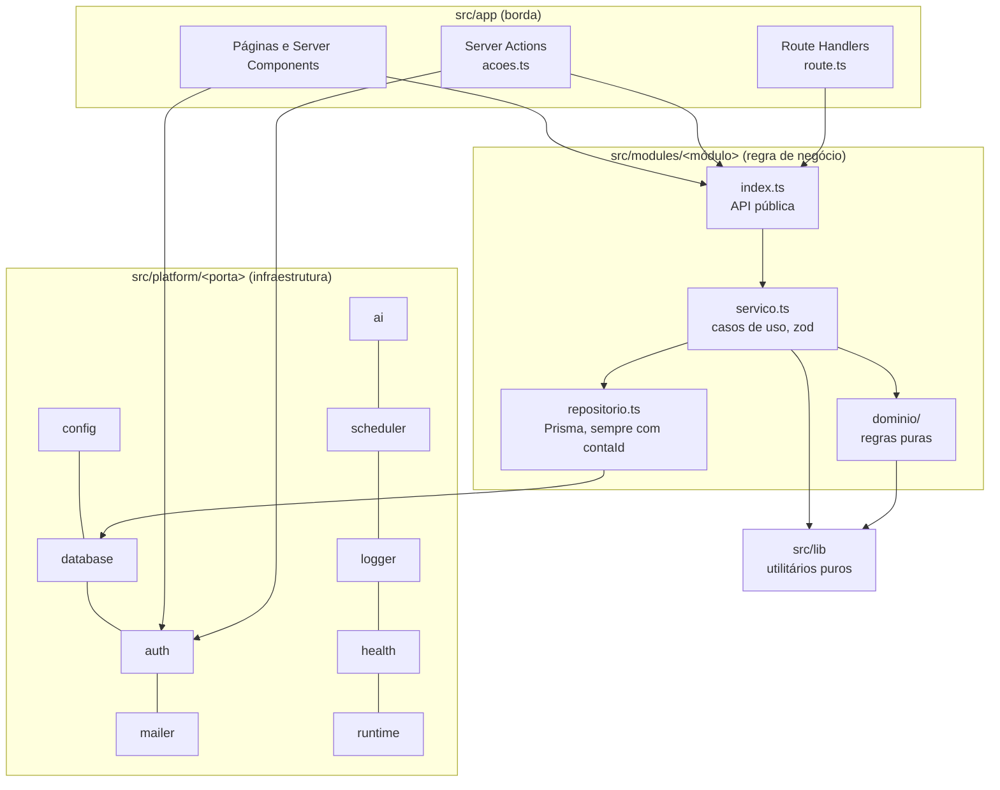
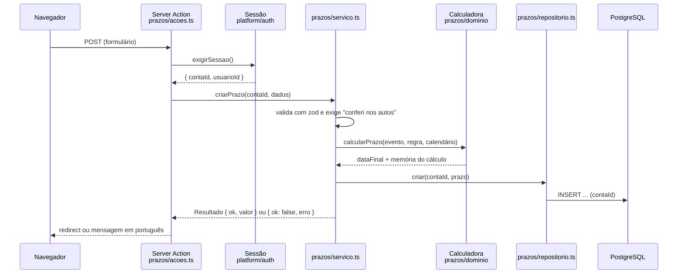

# Arquitetura

Como o Tempestivo é organizado, por que é assim e o que não pode mudar sem uma decisão registrada. Para o mapa de módulos e portas, veja [mapa-de-modulos.md](mapa-de-modulos.md); para o banco, [modelo-de-dados.md](modelo-de-dados.md); para as rotas, [rotas-e-api.md](rotas-e-api.md).

## Visão de contexto



Há um único processo de aplicação. Não existe fila, cache distribuído nem serviço de terceiros pago: tudo o que é externo (banco, e-mail, agendador, extrator de intimação) entra por uma porta em `src/platform/`.

## Camadas



| Camada | Pode importar | Não pode importar |
|---|---|---|
| `src/app` | `index.ts` dos módulos, `src/platform` (sessão, config, runtime), `src/components`, `src/lib` | o interior de um módulo; o Prisma |
| `src/modules/<m>` | o próprio interior, o `index.ts` de outro módulo, `src/platform`, `src/lib` | o interior de outro módulo; `src/app` |
| `src/platform/<p>` | `src/lib`, `config` | `src/modules`, `src/app` |
| `src/lib` | nada do projeto | tudo o resto |
| qualquer código | — | `@vercel/*` (portabilidade) |

As regras estão em `eslint.config.mjs` (`no-restricted-imports`) e são provadas por `src/lint/fronteiras.test.ts`. Banco, sessão e raiz de composição importam `server-only`, e o build falha se um componente de cliente tentar importá-los.

## Fluxo de uma requisição

Exemplo: o advogado salva um prazo calculado.



Toda escrita passa por uma Server Action (proteção contra CSRF do próprio Next.js, sem API JSON pública) e devolve um `Resultado`. Exceções ficam para falhas inesperadas, que caem em `error.tsx` sem detalhe técnico.

## Raiz de composição

`src/platform/runtime` monta as portas uma única vez por processo, a partir da configuração validada:

```ts
// src/platform/runtime/index.ts (resumo)
export const getMailer = () => (mailer ??= criarMailer(getConfig()));
export const getScheduler = () => (scheduler ??= criarScheduler(getConfig(), getLogger()));
```

Os serviços recebem as portas como parâmetro (`enviarAlertasPendentes({ mailer, logger, appUrl })`), e por isso os testes usam os adaptadores falsos (`fake-mailer`, `fake-logger`, `fake-extrator`) sem mock de módulo.

## Registro de decisões

Cada decisão segue o formato: contexto, decisão, consequências. Decisões novas entram no fim da lista, com o próximo número. Uma decisão substituída fica na lista, marcada como tal.

### D1. Monólito modular, não microsserviços

- **Contexto:** equipe de duas pessoas, prazo de um mês, custo zero.
- **Decisão:** um único app Next.js, com módulos isolados por `index.ts` e fronteiras impostas pelo lint.
- **Consequências:** um deploy e um banco. Extrair um módulo depois exige só trocar a chamada do `index.ts` por um cliente HTTP.

### D2. Portas e adaptadores para tudo o que é externo

- **Contexto:** o plano gratuito de qualquer provedor pode acabar; a regra 7 do projeto exige portabilidade.
- **Decisão:** banco, e-mail, agendador, IA, log e saúde ficam atrás de uma interface em `src/platform/`; nada de `@vercel/*`.
- **Consequências:** trocar de provedor é escrever um adaptador e mudar uma variável (`MAILER_DRIVER`, `AI_DRIVER`, `DATABASE_URL`). A mesma imagem Docker roda fora da Vercel.

### D3. Todo dado pertence a uma conta (`contaId`)

- **Contexto:** SaaS com dados pessoais de clientes de advogados (LGPD); vazamento entre contas é o pior incidente possível.
- **Decisão:** toda tabela de domínio tem `contaId`; todo método de repositório recebe `contaId` como primeiro parâmetro e filtra por ele, inclusive em `update` e `delete` (`updateMany`/`deleteMany` com `{ id, contaId }`).
- **Consequências:** cada módulo tem um teste de que a conta B não lê nem altera dados da conta A. Uma pessoa por conta, por enquanto; várias pessoas por conta está no roadmap.

### D4. Datas civis como texto `AAAA-MM-DD`

- **Contexto:** prazo processual é uma data, não um instante. `Date` com fuso causa erros de um dia na virada de horário e entre servidor (UTC) e usuário (America/Sao_Paulo).
- **Decisão:** prazos, vencimentos e dias sem expediente são `char(10)`; o fuso só aparece na borda (`src/lib/datas.ts`). Instantes reais (conferência, envio de e-mail, audiência) continuam `timestamp`.
- **Consequências:** comparação de datas é comparação de texto, e a calculadora é pura e testável.

### D5. Calculadora de prazos como domínio puro, que recusa em vez de chutar

- **Contexto:** errar um prazo tem consequência grave para o cliente do advogado, e as regras ainda não foram validadas por um advogado.
- **Decisão:** a calculadora não faz I/O, devolve o passo a passo com a referência legal e recusa (pede data manual) o que está fora do escopo: outros tribunais, Juizado Especial, dias corridos, prazo em horas. Enquanto as regras forem `pendente`, salvar uma data calculada exige a declaração "conferi nos autos".
- **Consequências:** ver [especificacoes/prazos.md](especificacoes/prazos.md) e `src/modules/prazos/regras.md`. Testes de propriedade cobrem dois anos de calendário.

### D6. Login próprio com Better Auth, com a API HTTP fechada

- **Contexto:** custo zero e dados no nosso banco; os limitadores de tentativa e o aceite dos termos vivem nas Server Actions.
- **Decisão:** Better Auth com Argon2id (`@node-rs/argon2`), sessão em cookie `HttpOnly`. A rota `/api/auth/*` só aceita os links dos e-mails (redefinição de senha e confirmação); o resto devolve 404.
- **Consequências:** ninguém contorna o limitador chamando a API direto. Login social está fora do escopo.

### D7. Jobs disparados por HTTP, idempotentes

- **Contexto:** a Vercel Hobby não oferece cron confiável no plano gratuito, e o app precisa rodar em qualquer lugar.
- **Decisão:** o GitHub Actions chama `POST /api/jobs/<nome>` a cada 2 horas com `Authorization: Bearer $JOBS_SECRET`, comparado em tempo constante. Cada alerta tem chave única `prazo:camada:data`, reservada no banco antes do envio.
- **Consequências:** repetir a chamada não duplica e-mail; qualquer cron que faça POST substitui o GitHub Actions.

### D8. Leitor de intimação local, por regras

- **Contexto:** a regra 6 proíbe mandar dados reais de clientes para IA gratuita; o texto da intimação tem nomes e números.
- **Decisão:** extrator por expressões regulares atrás da porta `ai`, que só gera rascunho, com o trecho de onde saiu cada campo. Um modelo de linguagem entra depois como outro driver, só com dados anonimizados.
- **Consequências:** nada sai do servidor; a cobertura de formatos de intimação é menor que a de um modelo.

### D9. Agenda por feed iCalendar, não por integração

- **Contexto:** o advogado olha o calendário do celular; integrar com as APIs do Google e da Microsoft exige OAuth, revisão de app e, em escala, custo.
- **Decisão:** feed `.ics` por URL secreta (256 bits, só o SHA-256 no banco), com conteúdo minimizado: nunca nome de cliente, parte ou assunto.
- **Consequências:** funciona em qualquer calendário sem configuração; quem tiver o link vê os vencimentos até ele ser trocado. Ver [especificacoes/agenda.md](especificacoes/agenda.md).

### D10. Vercel + Supabase como hospedagem padrão, Docker como saída

- **Contexto:** custo zero, região São Paulo, sem acoplar o código.
- **Decisão:** Vercel Hobby (`gru1`) e Supabase Free usado como PostgreSQL puro, pelo pooler de transação; migrações pelo pooler de sessão a partir do GitHub Actions. Imagem Docker com alvos `runner` e `migrator`, testada no CI.
- **Consequências:** ver [deploy.md](deploy.md). Sair da Vercel é subir a imagem em outro lugar com as mesmas variáveis.

### D11. Limitador de tentativas em memória

- **Contexto:** Redis ou KV custariam ou acoplariam ao provedor.
- **Decisão:** janela deslizante em memória (`src/lib/limitador.ts`), por IP e por e-mail.
- **Consequências:** o limite vale por instância e depende de o proxy sobrescrever `X-Forwarded-For` (a Vercel faz isso). Evolução: guardar as tentativas no PostgreSQL. Registrado em `SECURITY.md`.

## Atributos de qualidade

| Atributo | Como é garantido | Onde se verifica |
|---|---|---|
| Isolamento entre contas | `contaId` obrigatório nos repositórios | testes de integração de cada módulo |
| Correção dos prazos | domínio puro, casos conferidos, propriedades | `src/modules/prazos/**/__tests__` |
| Segurança | cabeçalhos (CSP, HSTS), Argon2id, tokens só como resumo, segredos validados | `seguranca.yml`, [SECURITY.md](../SECURITY.md) |
| Portabilidade | portas, lint contra `@vercel/*`, imagem Docker | job `imagem` do CI |
| Acessibilidade | WCAG 2.2 AA: contraste testado, verificação estrutural em todas as rotas | `src/test/contraste.test.ts`, `e2e/acessibilidade.spec.ts` |
| Mobile-first | 360, 768 e 1280 px, sem rolagem horizontal | todos os testes de tela |
| Manutenibilidade | módulos pequenos, cobertura mínima, tipos estritos | `pnpm verificar`, `pnpm test:cobertura` |
