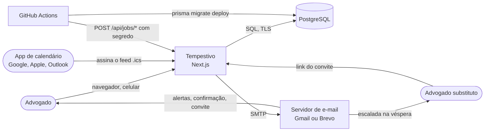
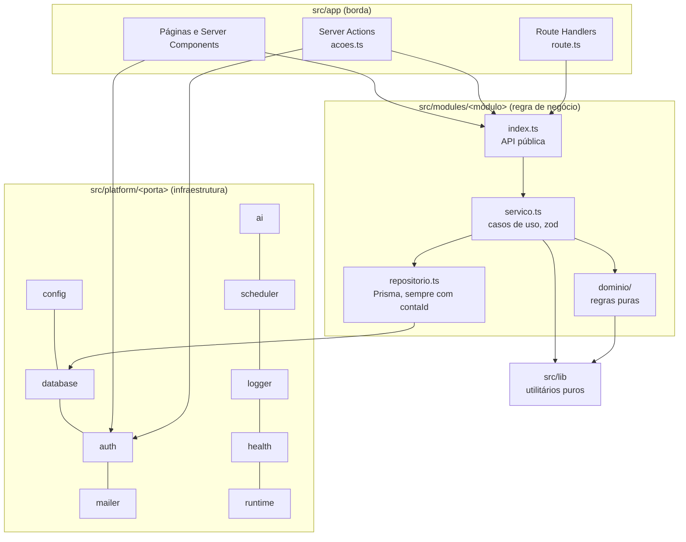
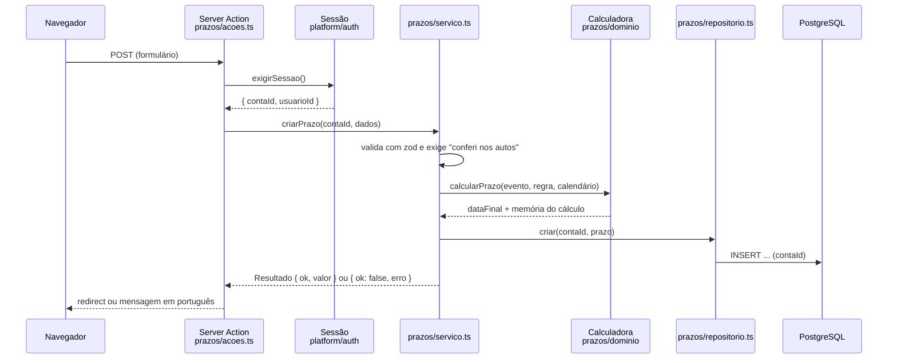

# Arquitetura

Como o Tempestivo é organizado e o que o código impõe. Veja também os [módulos e portas](modulos.md), o [modelo de dados](modelo-de-dados.md), as [rotas e interfaces](../referencia/rotas-e-interfaces.md) e as [decisões](../adr/README.md).

## Visão de contexto



Há um único processo de aplicação. Não existe fila, cache distribuído nem serviço de terceiros pago: tudo o que é externo (banco, e-mail, agendador, extrator de intimação) entra por uma porta em `src/platform/`.

## Camadas



| Camada | Pode importar | Não pode importar |
|---|---|---|
| `src/app` | `index.ts` dos módulos, `src/platform` (sessão, config, runtime), `src/components`, `src/lib` | o interior de um módulo; o Prisma |
| `src/modules/<m>` | o próprio interior, o `index.ts` de outro módulo, `src/platform`, `src/lib` | o interior de outro módulo; `src/app` |
| `src/platform/<p>` | `src/lib`, `config` | `src/modules`, `src/app` |
| `src/lib` | nada do projeto | tudo o resto |
| qualquer código | — | `@vercel/*` (portabilidade) |

As regras estão em `eslint.config.mjs` (`no-restricted-imports`) e são provadas por `src/lint/fronteiras.test.ts`. Banco, sessão e raiz de composição importam `server-only`, e o build falha se um componente de cliente tentar importá-los.

## Fluxo de uma requisição

Exemplo: o advogado salva um prazo calculado.



Toda escrita passa por uma Server Action (proteção contra CSRF do próprio Next.js, sem API JSON pública) e devolve um `Resultado`. Exceções ficam para falhas inesperadas, que caem em `error.tsx` sem detalhe técnico.

## Raiz de composição

`src/platform/runtime` monta as portas uma única vez por processo, a partir da configuração validada:

```ts
// src/platform/runtime/index.ts (resumo)
export const getMailer = () => (mailer ??= criarMailer(getConfig()));
export const getScheduler = () => (scheduler ??= criarScheduler(getConfig(), getLogger()));
```

Os serviços recebem as portas como parâmetro (`enviarAlertasPendentes({ mailer, logger, appUrl })`), e por isso os testes usam os adaptadores falsos (`fake-mailer`, `fake-logger`, `fake-extrator`) sem mock de módulo.

## Decisões de arquitetura

O motivo de cada escolha está no [registro de decisões](../adr/README.md). As que mais restringem o código: [portas e adaptadores](../adr/0002-portas-e-adaptadores.md), [isolamento por conta](../adr/0003-isolamento-por-conta.md), [datas civis como texto](../adr/0004-datas-civis-como-texto.md) e [calculadora que recusa](../adr/0005-calculadora-de-prazos-pura.md).

## Atributos de qualidade

| Atributo | Como é garantido | Onde se verifica |
|---|---|---|
| Isolamento entre contas | `contaId` obrigatório nos repositórios | testes de integração de cada módulo |
| Correção dos prazos | domínio puro, casos conferidos, propriedades | `src/modules/prazos/**/__tests__` |
| Segurança | cabeçalhos (CSP, HSTS), Argon2id, tokens só como resumo, segredos validados | `seguranca.yml`, [SECURITY.md](../../SECURITY.md) |
| Portabilidade | portas, lint contra `@vercel/*`, imagem Docker | job `imagem` do CI |
| Acessibilidade | WCAG 2.2 AA: contraste testado, verificação estrutural em todas as rotas | `src/test/contraste.test.ts`, `e2e/acessibilidade.spec.ts` |
| Mobile-first | 360, 768 e 1280 px, sem rolagem horizontal | todos os testes de tela |
| Manutenibilidade | módulos pequenos, cobertura mínima, tipos estritos | `pnpm verificar`, `pnpm test:cobertura` |
