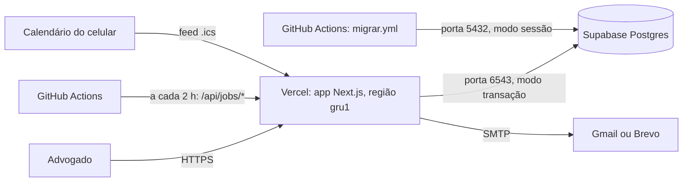

# Deploy

O caminho principal é **Vercel (plano Hobby) + Supabase (plano gratuito)**, de custo zero. O app só conhece variáveis de ambiente e o PostgreSQL padrão, então trocar de hospedagem ou de banco é trocar variáveis: a imagem Docker do [caminho B](#caminho-b-imagem-docker) roda em qualquer lugar.

> **Estado deste roteiro:** os passos de Vercel e Supabase seguem a documentação oficial (consultada em 17/11/2026), mas **ainda não foram executados** com contas reais. O que está provado é o que o CI roda a cada push: build sem variáveis, migrações em Postgres 17 e a imagem Docker subindo, migrando e respondendo em `/api/health`.

## Arquitetura do deploy



O Supabase é usado só como PostgreSQL: o app não usa a API, a autenticação nem o armazenamento do Supabase. Nada exclusivo da Vercel é usado (KV, Blob, Edge Config, Cron).

## Variáveis de ambiente

A lista completa, com um comentário por variável, está em [`.env.example`](../.env.example). Variável ausente ou inválida derruba a subida com a lista dos nomes (nunca dos valores).

| Variável | Produção na Vercel |
|---|---|
| `NODE_ENV` | `production` (a Vercel já define) |
| `APP_URL` | URL pública em `https`, sem barra no final. Entra nos links dos e-mails, no feed da agenda e nos cookies |
| `JOBS_SECRET` | 64 caracteres aleatórios. O mesmo valor vai nos segredos do GitHub |
| `AUTH_SECRET` | 64 caracteres aleatórios, diferente do anterior. Trocar encerra todas as sessões |
| `DATABASE_URL` | Supavisor em **modo transação**: `postgresql://postgres.<ref>:<senha>@<host-do-pooler>:6543/postgres?pgbouncer=true` |
| `DATABASE_POOL_MAX` | `3` (cada função serverless abre poucas conexões; o pooler multiplexa) |
| `DATABASE_CA_CERT` | Certificado do Supabase (Database > SSL Configuration > Download certificate), colado como texto. Com ele, o TLS é verificado |
| `MAILER_DRIVER` | `smtp` |
| `SMTP_HOST`, `SMTP_PORT`, `SMTP_USER`, `SMTP_PASS`, `EMAIL_REMETENTE` | Gmail (senha de app, porta 587) ou Brevo |
| `LOG_LEVEL` | `info` |
| `AI_DRIVER` | `local` |

Gere cada segredo com:

```bash
node -e "console.log(require('crypto').randomBytes(32).toString('hex'))"
```

Nunca reutilize um segredo de produção em *Preview*, no CI ou na máquina de desenvolvimento. Marque os segredos como *Sensitive* na Vercel.

### Qual conexão do Supabase usar em cada lugar

| Onde | Conexão | Porta | Por quê |
|---|---|---|---|
| App na Vercel (`DATABASE_URL`) | Supavisor, modo transação, com `?pgbouncer=true` | 6543 | Funções serverless abrem muitas conexões curtas; o modo transação não aceita *prepared statements*, e o parâmetro avisa o Prisma |
| Migrações no GitHub Actions (`DATABASE_URL_MIGRACAO`) | Supavisor, modo sessão | 5432 | A conexão direta do plano gratuito é só IPv6, e os runners do GitHub são IPv4 |
| Sua máquina, se precisar | Conexão direta ou modo sessão | 5432 | — |

O host do pooler tem a forma `aws-<n>-<região>.pooler.supabase.com`, mas o `<n>` não se deduz da região: copie a string do botão **Connect** do painel do Supabase. Senha com `&`, `#`, `?` ou espaço precisa de *percent-encoding*.

## Caminho A: Vercel + Supabase

1. **Repositório.** O plano Hobby da Vercel não faz deploy de repositório privado de organização. Escolha: tornar o repositório público, espelhar a `main` em um repositório pessoal privado ou usar o caminho B.
2. **Supabase.** Crie um projeto só de produção, na região `South America (São Paulo)`. Anote a senha do banco. No botão **Connect**, copie a string do modo transação (para a Vercel) e a do modo sessão (para o GitHub). Baixe o certificado em Database > SSL Configuration.
3. **Segredos do GitHub** (Settings > Secrets and variables > Actions):

   | Segredo | Valor |
   |---|---|
   | `DATABASE_URL_MIGRACAO` | string do modo sessão |
   | `APP_URL` | URL pública do app |
   | `JOBS_SECRET` | o mesmo valor configurado na Vercel |

   Em Settings > Environments, crie o ambiente `producao` com revisores obrigatórios: o `migrar.yml` só roda depois da aprovação.
4. **Migrar.** Rode o workflow **Migrar o banco de produção** e digite `migrar`.
5. **Vercel.** Importe o repositório (o Next.js é detectado; o [`vercel.json`](../vercel.json) fixa a região `gru1`, em São Paulo, perto do banco). Cadastre as variáveis da tabela **antes** do primeiro deploy, em *Production*. Node 24.x. Se a instalação usar outro pnpm, defina `ENABLE_EXPERIMENTAL_COREPACK=1`.
6. **Conferir.**
   1. `GET /api/health` responde `{"status":"ok","banco":"ok",...}`.
   2. Crie uma conta e **confirme o e-mail** pelo link recebido (sem isso nenhum alerta é enviado).
   3. Cadastre um prazo e rode o workflow **Jobs agendados** à mão: o alerta deve chegar.
   4. Em Conta, crie o link da agenda e assine no celular.

O Hobby é para uso não comercial: serve ao desafio, mas cobrar honorários de clientes reais exige rever o plano.

### Pull requests e *Preview*

Cada pull request gera um *Preview* na Vercel. Ele **não pode** apontar para o banco de produção: crie um segundo projeto gratuito no Supabase só para *Preview*, com dados fictícios, e configure as variáveis do ambiente *Preview* com ele. Sem isso, deixe o *Preview* sem variáveis: o app não sobe, e nenhum dado de produção fica exposto.

## Caminho B: imagem Docker

```bash
docker build --target runner   -t tempestivo .
docker build --target migrator -t tempestivo-migrador .
docker run --rm --env-file .env tempestivo-migrador
docker run -d -p 3000:3000 --env-file .env tempestivo
```

A imagem roda sem root, sem gerenciador de pacotes e tem `HEALTHCHECK` em `/api/health`. Serve para qualquer hospedagem de contêiner (Render, Fly.io, Railway, uma VPS). Coloque um proxy com TLS na frente e use qualquer PostgreSQL 15 ou mais novo.

**Atenção ao proxy:** o limitador de tentativas identifica o cliente pelo cabeçalho `X-Forwarded-For`. O proxy precisa **sobrescrever** esse cabeçalho com o IP real; se repassar o que o cliente mandou, o limite pode ser burlado. A Vercel já faz isso.

## Agendador (alertas de prazo)

O workflow **Jobs agendados** (`jobs.yml`) chama `/api/jobs/ping` e `/api/jobs/alertas` a cada 2 horas, com os segredos `APP_URL` e `JOBS_SECRET`. Sem eles, o job termina com um aviso e não chama nada. Os jobs são idempotentes: repetir uma chamada não duplica e-mail. O `ping` também mantém ativo o banco do plano gratuito, que pausa por inatividade.

Qualquer outro agendador que faça `POST` com `Authorization: Bearer <JOBS_SECRET>` serve no lugar dele.

## Ordem de uma entrega e reversão

1. **Migração primeiro, código depois.** Toda migração precisa ser compatível com o código que já está no ar: acrescente colunas e tabelas; para renomear ou remover, faça em duas entregas (primeiro o código deixa de usar, depois a migração remove).
2. **Publicação.** O merge na `main` publica na Vercel.
3. **Verificação.** `/api/health` e um fluxo curto (entrar, abrir o painel).
4. **Reversão do app.** Na Vercel, *Deployments* > o deploy anterior > **Instant Rollback**: volta em segundos, sem novo build. No caminho B, suba a imagem da versão anterior.
5. **Reversão do banco.** O Prisma não desfaz migrações sozinho. Como as migrações só acrescentam, a versão anterior do app continua funcionando com o banco novo; se for preciso desfazer, escreva uma migração nova que reverta a mudança.

## Se algo falhar

| Sintoma | Causa provável |
|---|---|
| Toda requisição responde 500 logo após o deploy | Variável faltando ou inválida. O log mostra `Configuração inválida. Corrija as variáveis: ...` |
| `/api/health` responde 503 | O app não alcança o banco: confira `DATABASE_URL`, o certificado e se o projeto do Supabase está pausado |
| `prepared statement "..." already exists` | `DATABASE_URL` no modo transação sem `?pgbouncer=true` |
| `self-signed certificate in certificate chain` | `DATABASE_CA_CERT` vazio ou incompleto |
| `remaining connection slots are reserved` | `DATABASE_POOL_MAX` alto demais para o plano; use 3 |
| O workflow de migração não conecta | `DATABASE_URL_MIGRACAO` com a conexão direta (só IPv6); use o modo sessão |
| Erro de tabela inexistente | As migrações não foram aplicadas |
| O e-mail de alerta não chega | E-mail da conta não confirmado (o painel avisa); `MAILER_DRIVER` em `fake`; credenciais SMTP erradas (o log registra `falha ao enviar alerta`, sem o endereço) |
| O substituto não recebe a escalada | Ele ainda não aceitou o convite (a tela Conta mostra a situação) |
| A agenda do celular não atualiza | O link foi trocado ou desligado na tela Conta; o Google Agenda atualiza feeds assinados a cada poucas horas |
| `Jobs agendados` falha com 401 | `JOBS_SECRET` do GitHub diferente do da Vercel |
