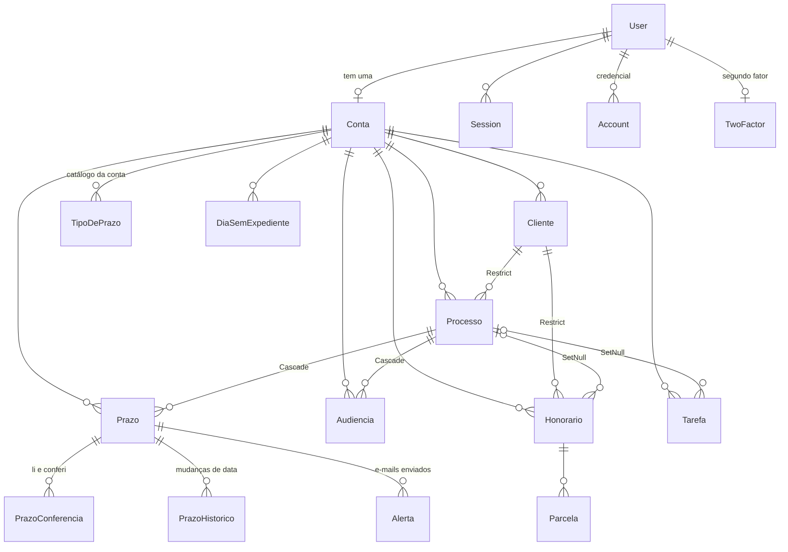

# Modelo de dados

O esquema fica em [`prisma/schema.prisma`](../prisma/schema.prisma), e as migrações versionadas em `prisma/migrations/`. Este documento explica as entidades, as regras que o banco garante e como mudar o esquema.

## Diagrama

Só as relações principais; o detalhe de cada campo está no esquema.



## Convenções

| Convenção | Regra | Motivo |
|---|---|---|
| Dono do registro | Toda tabela de domínio tem `contaId`, com `onDelete: Cascade` a partir de `Conta` | Isolamento entre contas (regra 3) e exclusão completa pela LGPD |
| Identificador | `cuid()` em texto | Não revela volume nem ordem de cadastro |
| Data civil | `char(10)` no formato `AAAA-MM-DD` (`dataFinal`, `vencimento`, `limite`, `data`) | Prazo é data, não instante; sem erro de fuso. Ver a decisão D4 em [arquitetura.md](arquitetura.md) |
| Instante | `timestamp` em UTC (`criadoEm`, `em`, `inicio` da audiência, `pagaEm`) | Algo que aconteceu num momento real |
| Dinheiro | `integer` em centavos (`valorCentavos`) | Sem erro de ponto flutuante; formatação em `src/lib/dinheiro.ts` |
| Segredo | Só o resumo SHA-256 (`tokenHash`, `substitutoTokenHash`, `agendaTokenHash`), com índice único | Um vazamento do banco não entrega links válidos |
| Nome da tabela | `@@map` em minúsculas com `_` (`prazo_conferencia`) | Padrão do PostgreSQL |
| Índices | Começam por `contaId` | Toda consulta filtra pela conta |

## Entidades

### Autenticação (Better Auth)

`User`, `Session`, `Account`, `Verification` e `TwoFactor` seguem o esquema do Better Auth, com os nomes de campo dele. A senha (Argon2id) fica em `Account.password`. Só a porta `src/platform/auth` mexe nessas tabelas.

- `TwoFactor` existe para quem começou a ligar a verificação em duas etapas: `secret` e `backupCodes` são cifrados com o `AUTH_SECRET`; `failedVerificationCount` e `lockedUntil` guardam o bloqueio. `User.twoFactorEnabled` só vira `true` depois de um código válido.
- `Verification` também guarda, por 2 minutos, os códigos do aplicativo já usados (`totp-usado:<usuário>`), para não serem aceitos de novo.

### `Conta`

Uma por usuário (`usuarioId` único). Guarda o nome do escritório e as preferências:

| Campo | Para quê |
|---|---|
| `substitutoNome`, `substitutoEmail`, `substitutoConfirmadoEm` | Colega que recebe a escalada na véspera; só recebe depois de aceitar |
| `substitutoTokenHash`, `substitutoTokenExpiraEm` | Convite de uso único ao substituto |
| `termosAceitosEm`, `versaoDosTermos` | Prova do aceite (LGPD); a versão vem de `src/lib/termos.ts` |
| `margemDeSegurancaDiasUteis` | Meta interna, de 0 a 10 (padrão 2) |
| `agendaTokenHash`, `agendaAtivadaEm` | Agenda assinável; nulo quando desligada |

### `Cliente` e `Processo`

- `Processo.numero` é único **por conta** (`@@unique([contaId, numero])`), guardado só com dígitos e formatado no padrão CNJ na tela.
- Apagar um cliente com processos é bloqueado (`Restrict`): o advogado arquiva ou apaga os processos antes.
- `Processo.status` é `ativo` ou `arquivado`; arquivar não apaga prazos.

### `Prazo`

| Campo | Observação |
|---|---|
| `dias`, `contagem`, `emDobro`, `tipoEvento`, `dataEvento`, `dataInicio` | Entrada da calculadora; nulos quando a data final é manual |
| `dataFinal` | Sempre preenchida |
| `origemDataFinal` | `calculada` ou `manual` |
| `memoriaDoCalculo` | JSON com os passos, as regras e os avisos ("como contamos") |
| `status` | `pendente` → `confirmado` (alguém conferiu) → `cumprido` |
| `ultimaConferenciaEm` | Base do "status honesto" (há quantos dias foi conferido) |

Vencimento, urgência e meta interna **não são colunas**: são derivados na leitura (`situacaoDoPrazo`), para nunca ficarem desatualizados.

- `PrazoConferencia` registra cada "li e conferi", com o canal (`app` ou `email`).
- `PrazoHistorico` registra cada mudança de campo relevante, com o valor anterior e o novo.

### `TipoDePrazo` e `DiaSemExpediente`

- `TipoDePrazo` guarda os ajustes da conta sobre o catálogo base (`chaveBase` preenchida, única por conta) e os tipos criados pelo advogado (`chaveBase` nula).
- `DiaSemExpediente` é único por conta, tribunal e data. Alimenta a calculadora e a meta interna.

### `Alerta`

Cada linha é um e-mail **reservado antes do envio**. A `chave` única `prazoId:camada:dataFinal` torna o job idempotente: rodar duas vezes não duplica, e mudar a data final gera alertas novos. `tokenHash`, `tokenExpiraEm` e `tokenUsadoEm` implementam o link "li e conferi" de uso único.

### `Audiencia`, `Honorario`, `Parcela`, `Tarefa`

- `Audiencia.inicio` é instante (tem hora); `duracaoMin` padrão 60.
- `Parcela` é única por honorário e número; `pagaEm` nulo significa em aberto. A situação (vencida, a vencer) é derivada na leitura.
- `Tarefa.coluna` é `a_fazer`, `fazendo` ou `feito`, ordenada por `ordem`. Apagar o processo mantém a tarefa (`SetNull`).

## Migrações

| Migração | O que mudou |
|---|---|
| `20261112222208_inicial` | Esquema completo do MVP |
| `20261117190000_substituto_com_aceite` | Convite e aceite do substituto |
| `20261117200000_aceite_dos_termos` | Data e versão do aceite dos termos |
| `20261117210000_agenda_e_meta_interna` | Margem da meta interna e link da agenda |
| `20261126030015_segundo_fator` | Verificação em duas etapas: tabela `twoFactor` e `user.twoFactorEnabled` (só acrescenta) |

### Como mudar o esquema

1. Altere `prisma/schema.prisma`.
2. Gere a migração: `pnpm db:migrar --name <nome_em_portugues>`. Em ambiente sem terminal interativo, gere o SQL com:
   ```bash
   pnpm prisma migrate diff --from-config-datasource --to-schema prisma/schema.prisma --script
   ```
   e salve em `prisma/migrations/<AAAAMMDDHHMMSS>_<nome>/migration.sql`.
3. Aplique e regenere o cliente: `pnpm db:aplicar` e `pnpm prisma generate`.
4. Inclua a migração no mesmo PR. O CI falha se o esquema tiver mudança sem migração (`migrate diff --exit-code`).
5. Em produção, a migração roda pelo workflow **Migrar o banco de produção**, antes do deploy do código que depende dela.

Regras: migração nunca é editada depois de entrar na `main`; coluna nova em tabela com dados precisa de padrão ou ser opcional; remover coluna é feito em duas entregas (o código para de usar, depois a coluna sai).

## Retenção e exclusão

- Excluir a conta apaga o `User`, e a cascata leva a `Conta` e todos os registros dela.
- A exportação (`exportarDadosDaConta`) traz todos os dados da conta em JSON, sem `contaId`, senha, resumos de token nem os dados do segundo fator.
- Não há exclusão lógica (`deletedAt`): apagar é apagar.
